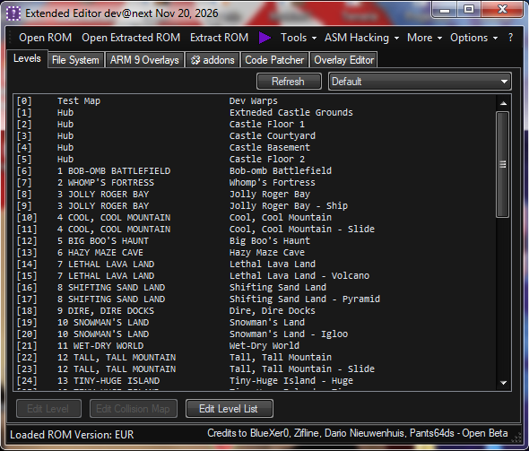
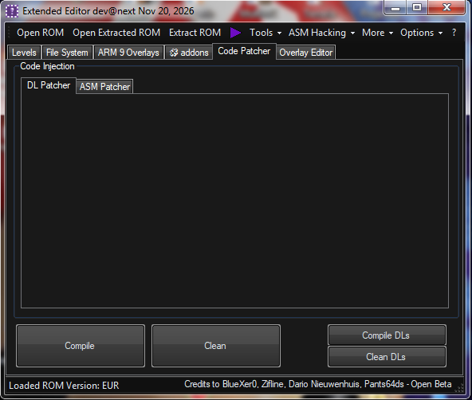
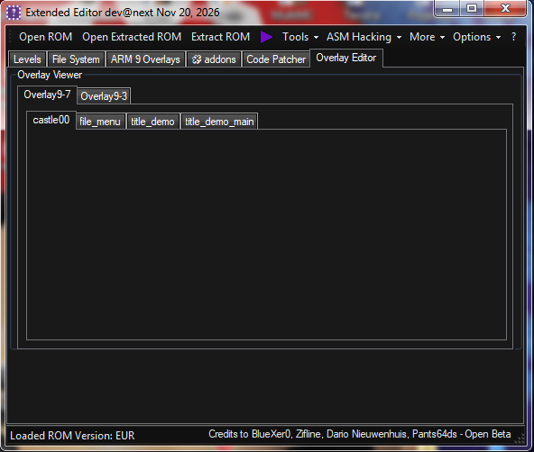

# Extended Editor

Extended Editor is a Fork of SM64DSe that adds a lot of wanted and ease of access features

- This Editor is still in Open Beta and is a Heavy W.I.P

# "Features as of Right Now"

- *This will be updated everytime something new gets added so check back on this*

# ASM / DL Code Injector

# Extended Editor has the NSMBe code Patcher Baked in to make ASM patching more efficient and quick so you can have more development time

  this also has a built in DL Patcher also so you can make DLs inside the editor and not in the command prompt
  so you dont have to close the editor anymore every time you make DLs!

# GUI Overlay Editor

  This part of the Extended Editor has a Built in GUI Editor meaning you can replace Graphics with images without
  having to do all of that Overlay Hex Editing Stuff. this is also made for ease of access to new comers of the modding scene

